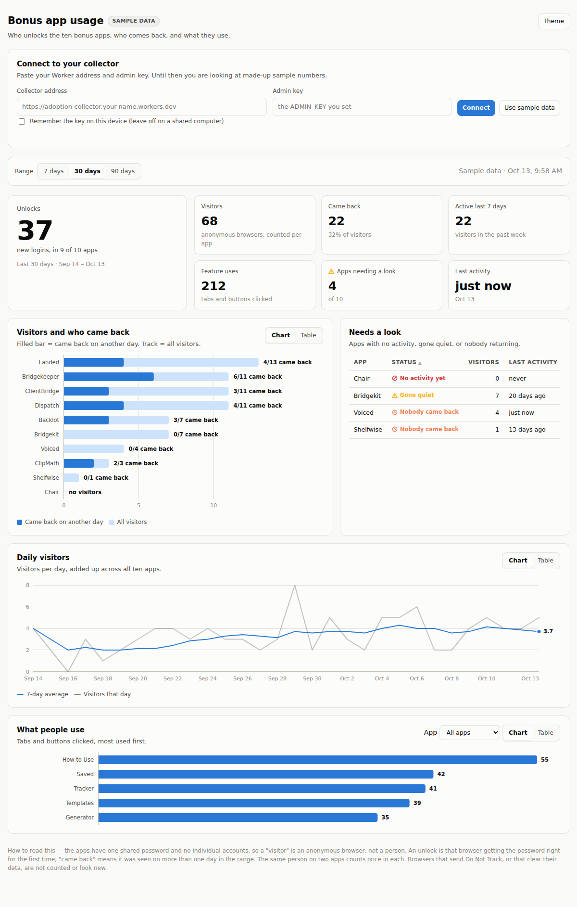

# Bonus app usage

Tracks **logins and usage of the ten bonus apps**, using nothing but your own code: no
analytics vendor, and no third-party script in any app.

| App | Launch it is a bonus for | Address |
|---|---|---|
| Landed | DoneOnCommand | landed.misanmorrison.com |
| ClientBridge | ProsperaBuilder | clientbridge.misanmorrison.com |
| Bridgekit | WPSync | bridgekit.misanmorrison.com |
| Dispatch | Claw AI Army | dispatch.misanmorrison.com |
| Voiced | MagicFlixAI 2.0 | voiced.misanmorrison.com |
| Backlot | CinematicSitesAI | backlot.misanmorrison.com |
| ClipMath | ReelRemix | clipmath.misanmorrison.com |
| Bridgekeeper | AgenticAffiliate | bridgekeeper.misanmorrison.com |
| Chair | ClickStaffAI | chair.misanmorrison.com |
| Shelfwise | ProductsPilot | shelfwise.misanmorrison.com |



## Why this exists

The apps are static, password-gated sites on GitHub Pages. They have no backend and make
no network calls, and GitHub Pages keeps no visitor logs, so **nothing records who logs in
or what they use.** Three small pieces fix that:

```
bonus app --(tracker/track.js)--> POST /e     \
                                               >  collector/  (Cloudflare Worker + D1)
this dashboard <-----------------  GET  /stats /
```

| Piece | What it is |
|---|---|
| `tracker/track.js` | One file, identical in all ten apps. Reports `unlock`, `open` (return visit) and `use` (tab or button clicked). |
| `collector/` | The receiver. Stores events and serves totals behind an admin key. |
| `index.html` | This dashboard. Shows sample data until you connect it to your collector. |

## What "login" means here

Each app has **one shared password and no individual accounts**. So the dashboard counts
**anonymous browsers, not people**:

- **Unlock**: a browser got the password right for the first time.
- **Came back**: the same browser was seen on more than one day in the range.
- The same person on two apps counts once in each, and a visitor who clears their browser
  data looks new. Browsers that send Do Not Track are not counted at all.
- Counts are **indicative, not tamper-proof**: the collector accepts requests from the
  open internet, so a determined person could forge events.

Stored: app, event type, tab or button label, a random browser id, server time.
Never stored: IP address, user agent, email, or anything a visitor typed.

## Setting it up

1. **Deploy the collector** to your own Cloudflare account: [`collector/README.md`](collector/README.md).
   Your DNS can stay at Namecheap. You end up with an address like
   `https://adoption-collector.<you>.workers.dev` and an `ADMIN_KEY` you chose.
2. **Install the tracker** in the ten apps. Check out each app into one folder, named by its
   slug, then preview and run the installer. It adds one line per app and never touches git.
   ```sh
   node tracker/install.mjs --endpoint https://adoption-collector.<you>.workers.dev --repos ~/apps --dry-run
   node tracker/install.mjs --endpoint https://adoption-collector.<you>.workers.dev --repos ~/apps
   ```
   Then in each repo: review `git diff`, commit and push. ClipMath's app lives on its
   `main` branch, not its default one.
3. **Open the dashboard**, paste the collector address and admin key, press Connect.
   The key is kept for that browser tab only, unless you tick "remember".

Keep `ADMIN_KEY` out of this repo. It is public, so never commit real numbers here either.

## Checking it works

```sh
cd collector && npm test      # 13 tests: the Worker's real SQL, run against SQLite
```

The tracker and dashboard were also tested in a real browser against the actual Worker code.
That used copies of all ten apps with a test password, not your live sites or passwords.

## Status

- [x] Collector, tracker, installer, dashboard built and tested locally
- [ ] Collector deployed to Cloudflare (needs your account; steps are unverified against a live one)
- [ ] Tracker installed and pushed in the ten app repos
- [ ] First real events seen in the dashboard

## Unused files from an earlier misunderstanding

This repo first tracked **paid software licences** (Slack, Salesforce and so on) before it was
clear the apps are your own. These files are no longer used and can be deleted:
`data/`, `tools/generate-data.mjs`, `tools/import-csv.mjs`, `tools/validate-data.mjs`,
`tools/lib/csv.mjs`. They remain in git history either way.
